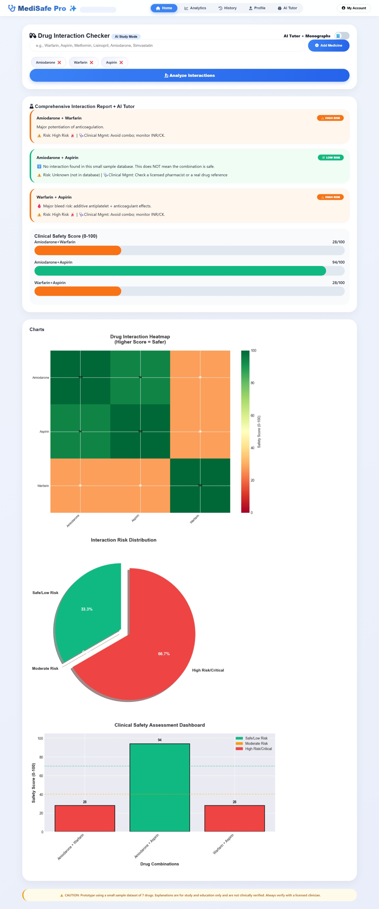

# MediSafe Pro: Drug Interaction Checker

A prototype web app that checks pairwise interactions between medicines and
shows the results with charts. Built for learning; it uses a small sample
dataset and is NOT a clinical tool.

## Features
- Add multiple medicines and check every pair for known interactions
- Color-coded results with severity, mechanism and management notes
- Charts (bar, pie, heatmap) generated by a Flask backend using Matplotlib
- Profile, history and usage stats saved in the browser (localStorage)

## Tech Stack
Flask, Flask-CORS, Matplotlib, NumPy, HTML, CSS, JavaScript

## How to Run
1. Install Python 3
2. `py -m pip install -r requirements.txt` (or `python -m pip ...`)
3. `py app.py`
4. Open http://localhost:5000

## How It Works
1. The user adds medicines; the frontend looks up each pair in a built-in
   knowledge base.
2. Results are shown on the page.
3. The frontend sends the results to the Flask endpoint `/api/generate_graphs`.
4. Flask draws the charts with Matplotlib and returns them as base64 images,
   which the page displays.

## Limitations
- The dataset is a small sample (7 drugs) and is not clinically verified
- "No interaction found" only means the pair isn't in the sample data
- The explanation text is template-based, not generated by a live AI model
- For education and demonstration only; always consult a licensed clinician

## Screenshot

## Future Improvements
- Replace the sample data with a real source such as openFDA
- Add input validation and more drugs
- Deploy the backend so the demo is live